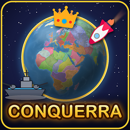
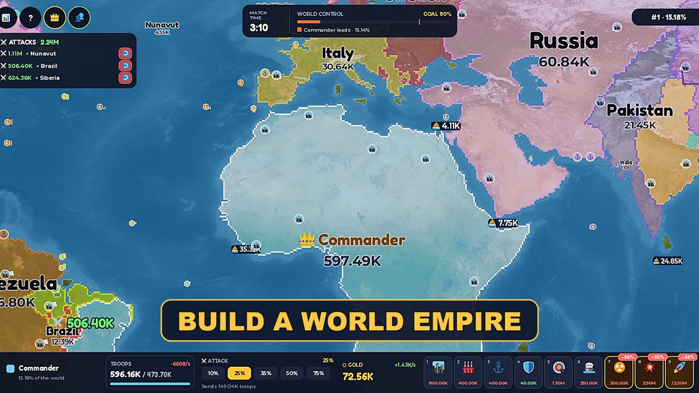
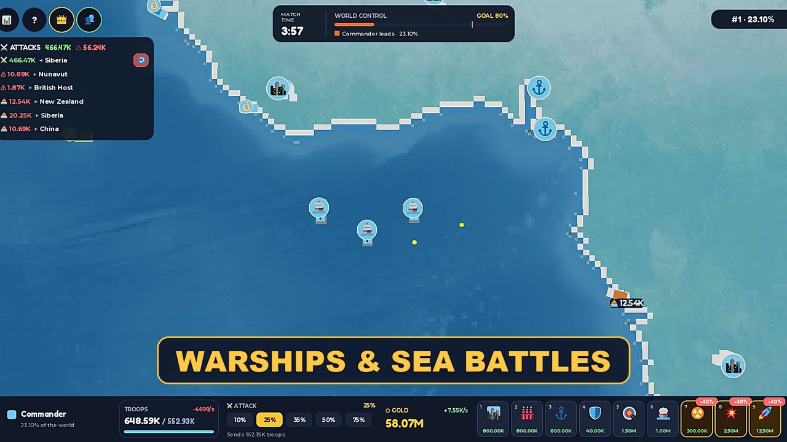
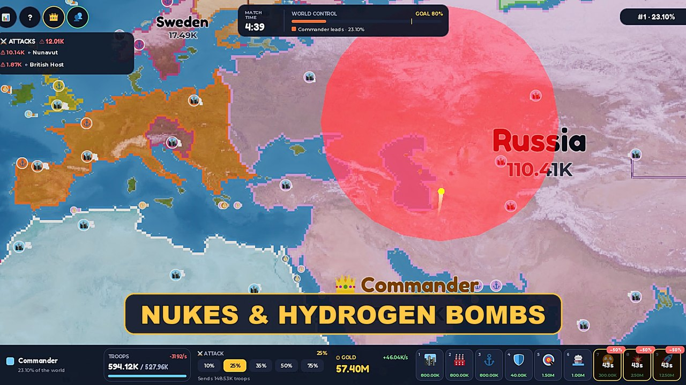
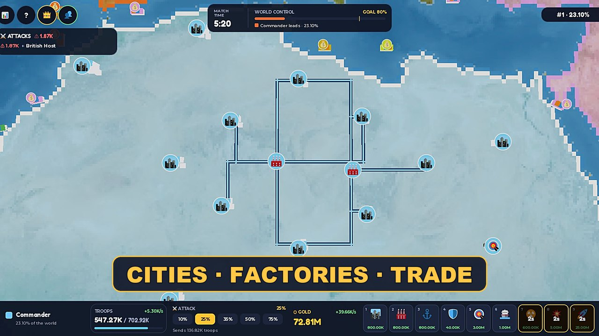
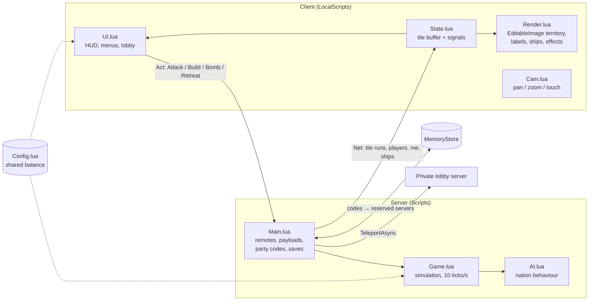

<p align="center">
  
</p>

<h1 align="center">Conquerra — Roblox</h1>

<p align="center">
  A real-time territorial strategy game on a map of the real world, built for Roblox.<br>
  <a href="https://www.roblox.com/games/114111231446296">▶ Play on Roblox</a> ·
  <a href="https://github.com/EmirMalikov/Conquerra">Browser version</a>
</p>

<p align="center">
  
  
  
  
</p>

## About

Conquerra is a Roblox remake of my browser strategy game. Players and 70 AI countries start
on a 1032 × 516 tile map of Earth and fight for 80 % of the world's land. You expand into neutral land,
attack neighbours, ship troops across oceans, build an economy, run a navy and, late in the game, launch
nuclear weapons.

This repository is a **portfolio showcase**. It contains the simulation core and selected parts of the client
so the architecture and the code quality can be reviewed. The map data, the full renderer and UI, and the
server networking / monetization layer are not published, so the game can't be cloned from this repo.

## Features

| Area | What it does |
| --- | --- |
| **Territory war** | Click land to attack with a chosen share of your army. Speed and losses follow the browser game's combat model: the bigger your advantage over the defender's whole army, the faster and cheaper the conquest. Attacks can be recalled (25 % of the troops are lost). |
| **Economy** | Troop growth and caps scale with territory and cities. Passive gold, factories linked to nearby cities by right-angle railroads, ports that send trade ships to other countries' ports. |
| **Navy** | Troop boats find sea routes with BFS. Warships patrol near your ports, sink enemy landings, duel other warships (health, reload, repair at port) and capture trade ships, which then sail to your port. |
| **Nukes & air defence** | Atom and Hydrogen bombs for everyone, a VIP-only MIRV that splits into 30 warheads. SAM launchers shoot down bombs aimed inside their radius. |
| **AI nations** | 44 map nations and 26 random tribes expand, build cities, ports, factories, SAMs and warships, pick weak neighbours and launch naval invasions. |
| **Play with friends** | "Your code / Friend's code": a 6-character code maps to a reserved private server. The host picks *Team* or *Free for all* and starts the match. In team mode friends can't hurt each other and win together. Roblox invites carry the code, so an invited friend lands straight in the lobby. |
| **UI** | Live attacks panel (outgoing in green, incoming in red, with recall buttons), build preview under the cursor with the reason a spot is invalid, leaderboard, tutorial, spectate-and-leave after defeat, phone support. |
| **Monetization** | One VIP game pass (MIRV, −50 % revenge bombs, crown, +10 % gold). No pay-to-win troops. |

## Architecture



* **Server-authoritative simulation.** `Game.lua` owns the world and steps it 10 times per second. Clients only
  send intents (`Attack`, `Build`, `Bomb`, `Retreat`, `LobbyStart`…), validated on the server.
* **Compact world state.** Tile owners live in a `buffer` (u16 per tile, 532 512 tiles). New clients get an
  RLE snapshot; afterwards only runs of changed tiles are broadcast every 0.15 s.
* **Attack fronts.** An attack keeps its own frontier set. Each tick it spends a "budget" proportional to the
  front length on tiles whose cost depends on terrain, defence posts and the attacker/defender ratio.
* **Pathfinding.** Boats, trade ships and warships use breadth-first search over ocean tiles with stamp
  buffers (no per-search allocation). Trade routes are cached per port pair, and new routes are rate-limited.
* **Rendering.** Territories are painted pixel-per-tile into `EditableImage`s laid over the satellite map
  (8 chunks of 258 × 258), with a part-based fallback when the image API is unavailable. Only dirty rows are
  uploaded each frame.
* **Private lobbies.** `TeleportService:ReserveServer` + `MemoryStoreService` hash map (code → access code,
  12 h TTL). A reserved server starts in a *Lobby* state that waits for the host.

## What's in this repository

```
src/
  shared/Config.lua               balance: troops, gold, buildings, bombs, ships, AI, VIP
  server/Game.lua                 the simulation: tiles, attacks, boats, trade, warships, bombs, SAMs, teams, win rules
  server/AI.lua                   AI nations and tribes
  client/State.lua                client mirror of the world + network decoding
  snippets/TerritoryRenderer.lua  EditableImage territory painter (excerpt of Render.lua)
  snippets/RailPaths.lua          right-angle railroads between factories and cities (excerpt of Render.lua)
  snippets/AttackPanel.lua        attacks panel with recall buttons (excerpt of UI.lua)
  snippets/PartyCodes.lua         lobby codes, reserved servers, invites (excerpt of Main.lua)
docs/media/                       screenshots and icon
```

The game is about 5,350 lines of Luau; about 2,350 of them are published here. Code comments are in Russian.

Not included on purpose: `MapData.lua` (the packed world map), the full `Render.lua`, `UI.lua` and `Cam.lua`,
and `Main.lua` (networking, saves, party service, purchases).

## Tech

Luau (no third-party libraries) · Roblox engine services: `buffer`, `EditableImage`,
`RemoteEvent`/`RemoteFunction`, `TeleportService`, `MemoryStoreService`, `DataStoreService`, `SocialService`,
`MarketplaceService` · Python (Pillow, OpenCV) for store art and the trailer.

## Credits & license

Conquerra started as a fork of [OpenFront.io](https://github.com/openfrontio/OpenFrontIO) (AGPL-3.0).
The Roblox version is a new implementation in Luau, but its combat, troop-growth and trade formulas are
ported from OpenFront, and the world map comes from OpenFront's map resources (CC BY-SA 4.0).

The code in this repository is released under the **GNU AGPL-3.0** (see `LICENSE`).
Screenshots, the icon and everything not published here © Emir Malikov, all rights reserved.
